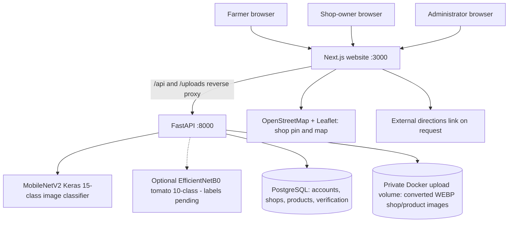

# Krushak Hithaishi system design — v3

This is a local multi-container web application. The design avoids a browser-to-backend localhost mismatch by putting the API behind the Next.js web origin.

## Farmer flow

1. Choose one supported crop and upload one clear leaf photo.
2. Server checks file type, size, dimensions and near-blank images.
3. The stored original MobileNetV2 model processes 224×224 RGB pixels using built-in scaling. The 15 ordered training labels determine the displayed class.
4. Crop mismatch, uncertain top score, invalid file and missing-model states do **not** claim a confirmed diagnosis.
5. A separate source-linked general information service provides observation and prevention notes **without chemical prescriptions**.
6. Farmer can opt in to locally saved scan metadata, then browse approved shops and open a phone call or external directions.

## Owner flow

1. Account registration/login via HTTP-only JWT cookie.
2. Shop details, Leaflet location selection, WEBP shop image upload.
3. Self-service add/edit/delete products and update owner-reported stock.
4. Shop submission is `draft → pending → approved/rejected`.
5. Admin reviews product listings independently; public listings show only approved products from approved shops.
6. Changing approved shop name/contact/address/coordinates/image requires re-verification; current owner remains able to manage own draft/listing.

## Data and safety constraints

- PostgreSQL stores users, shops, locations, products, moderation status, audit events and time stamps. Credentials are not committed.
- Role-based API authorization restricts writes to owner/admin; shop and product IDs are always checked server-side.
- Uploaded product/shop photos are restricted to valid JPEG/PNG/WEBP and converted to `.webp`. The API only accepts its own `/uploads/<id>.webp` paths.
- Map location is supplied by the owner; approval is a manual moderation state, not government certification.
- Unverified product suitability, stock, shop licensing and field diagnostic accuracy are **not asserted**.
- Direct phone/WhatsApp/online payments, license checks, weather-driven inference, automatic chemical recommendations, heatmaps and true browser-offline inference are not implemented.
- Public deployment requires more security hardening, backups, regulatory screening, local agricultural review and real field-image validation.
